# packet-engine

[](https://en.cppreference.com/w/cpp/23)
[](https://www.kernel.org/)

A C++23 userspace packet-processing engine for Linux with AF_XDP and optional
DPDK poll-mode I/O. It combines bounded RX/TX loops, zero-allocation packet
parsing, live firewall policy, byte-rate limiting, consistent hashing, IPv4
L4 NAT/conntrack, and Prometheus metrics.

This is a research and portfolio implementation, not a production firewall or
load balancer. Capability and benchmark claims below intentionally distinguish
what is implemented from what was proved on this host.

## Status and scope

| Area | Implemented behavior | Evidence boundary |
|---|---|---|
| AF_XDP | UMEM RX/TX, FILL/CQ recycling, custom XDP redirect program, actual-mode query | Requires a suitable interface, BPF/network capabilities, and memlock. Startup reports `mode=copy`, `mode=zero-copy`, or `mode=unknown`; only `zero-copy` is proof of AF_XDP zero-copy mode. |
| DPDK | EAL/ethdev initialization, one RX/TX queue, mbuf ownership and cleanup, bounded runtime | `net_pcap` is tested unprivileged. `net_af_packet` is a privileged, copy-backed veth demo. Neither proves PCI PMD kernel bypass or zero-copy. |
| Parser | Ethernet II, one VLAN tag, IPv4, IPv6 extension walk, TCP, UDP, ICMPv4; ICMPv6 classification; IPv4 and transport checksum validation | IPv4 TCP/UDP fragments fail closed. IPv4 UDP checksum zero is accepted by protocol; IPv6 UDP checksum zero is rejected. IPv6 is parsed, but live rule lookup and NAT are currently IPv4-only. |
| Policy | Exact IPv4 five-tuple, IPv4 CIDR longest-prefix match, `ALLOW`, `DROP`, `RATE_LIMIT`, `FORWARD` | Rule tables are built off-path and atomically swapped. `RATE_LIMIT` admits unchanged packets while tokens remain and drops after exhaustion. |
| L4 LB/NAT | Ketama consistent hashing, optional explicit backend pinning, backend health probing, conntrack, one-arm Ethernet next-hop rewrite, and in-place TCP/UDP checksum-safe IPv4 NAT | Enabled with `--vip`. A `FORWARD` rule without a usable backend, next-hop MAC, or NAT path fails closed. |
| Observability | RX, TX, drop counters and a Prometheus latency histogram | Histogram observations are batch processing durations in the current executable, not wire RTT. |
| Concurrency primitives | Cache-aligned descriptors, SPSC rings, NUMA topology/worker and frame-allocation components | The current executable is one queue and one run-to-completion polling thread. The tested worker/SPSC components are not presented as active multi-core runtime scaling. |

Kubernetes CNI integration is deliberately outside v1. A future demo could
expose this engine as a Multus secondary network, but this repository does not
install, configure, or claim a CNI plugin.

## Runtime architecture

```mermaid
flowchart TB
    %% packet-engine runtime architecture
    %% Single run-to-completion polling thread + control-plane jthread.

    %% ────────────────────────────────────────────────────────────────
    %% Dataplane: RX
    %% ────────────────────────────────────────────────────────────────
    subgraph RX["RX sources"]
        direction LR
        AF["AF_XDP UMEM<br/>veth · NIC · queue 0"]:::rx
        DP["DPDK ethdev queue 0<br/>net_pcap · net_af_packet"]:::rx
        RECV["recv_batch<br/>PacketDescriptor × &le; 64"]:::rx
        AF --> RECV
        DP --> RECV
    end

    %% ────────────────────────────────────────────────────────────────
    %% Dataplane: per-packet processing
    %% ────────────────────────────────────────────────────────────────
    subgraph PROC["Per-packet processing"]
        direction TB
        SNAP(("rules_snapshot<br/>atomic shared_ptr load")):::snap
        PARSE["parse_packet<br/>Ethernet II + VLAN tag<br/>IPv4 · IPv6 ext hdr walk<br/>TCP · UDP · ICMPv4 · ICMPv6<br/>zero-copy std::span views"]:::parse
        V4CHKV4{"IPv4 ?"}:::dec
        NATELIG{"NAT eligible ?<br/>IPv4 AND TCP/UDP AND --vip"}:::dec
        MUT["Build MutablePacket<br/>l3 / l4 offsets · csum offsets<br/>TCP flags"]:::nat
        EXIST["NatEngine::process_existing<br/>conntrack return-path<br/>swapped 5-tuple lookup"]:::nat
        HIT1(("return-path hit")):::snap
        LOOK["RuleTable::lookup_entry<br/>exact 5-tuple first<br/>then IPv4 CIDR LPM<br/>RATE_LIMIT token bucket"]:::rule
        ACT{"action"}:::dec
        FWDELIG{"FORWARD AND<br/>NAT eligible ?"}:::dec
        FWD["NatEngine::process_forward<br/>Ketama pick on original tuple<br/>ephemeral-port alloc<br/>flows_.try_lookup_or_create<br/>in-place IPv4 L3 + L4 rewrite<br/>incremental csum (RFC 1624)"]:::nat
        DEF["default_action<br/>DROP unless --default-action=allow"]:::snap

        RECV --> SNAP --> PARSE --> V4CHKV4
        V4CHKV4 -- "no (IPv6)" --> DEF
        V4CHKV4 -- "yes" --> NATELIG
        NATELIG -- "no" --> LOOK
        NATELIG -- "yes" --> MUT --> EXIST
        EXIST -- "hit" --> HIT1
        EXIST -- "miss" --> LOOK
        LOOK --> ACT
        ACT -- "ALLOW" --> TXOK(("forward")):::snap
        ACT -- "RATE_LIMIT<br/>(tokens)" --> TXOK
        ACT -- "DROP" --> DROP(("drop")):::drop
        ACT -- "FORWARD_TO_BACKEND" --> FWDELIG
        FWDELIG -- "no · fail-closed" --> DROP
        FWDELIG -- "yes" --> FWD
        FWD -- "TX_TO_BACKEND_INTERFACE" --> TXOK
        FWD -- "DROP · fail-closed" --> DROP
        DEF -- "ALLOW" --> TXOK
        DEF -- "DROP" --> DROP
    end

    %% ────────────────────────────────────────────────────────────────
    %% Dataplane: TX + ownership lifecycle
    %% ────────────────────────────────────────────────────────────────
    subgraph TX["TX (TransmitBatch)"]
        direction TB
        FB["forward<br/>transmit_descriptors"]:::tx
        DB["drop<br/>recycle_addresses (AF_XDP)<br/>or mbuf ledger (DPDK)"]:::tx
        SEND["backend.send_batch<br/>accepted = N"]:::tx
        KIND{"backend ?"}:::dec
        RX_REC["recycle_rx_addresses<br/>ACKed frames → UMEM FILL"]:::tx
        CPL["recycle_completions<br/>drain TX completion CQ"]:::tx
        FILL["service_fill_ring<br/>refill FILL ring"]:::tx
        REL["release_pending<br/>DPDK mbufs not accepted"]:::tx

        HIT1 --> FB
        TXOK --> FB --> SEND
        DROP --> DB --> REL
        SEND --> KIND
        KIND -- "AF_XDP" --> RX_REC --> CPL --> FILL
        KIND -- "DPDK" --> REL
    end

    %% ────────────────────────────────────────────────────────────────
    %% Dataplane: metrics
    %% ────────────────────────────────────────────────────────────────
    MET["record_rx · record_tx · record_drop · record_latency_us<br/>MetricsEndpoint over TCP :metrics_port<br/>Prometheus text format"]:::metrics
    SEND --> MET

    %% ────────────────────────────────────────────────────────────────
    %% Control plane (separate jthread)
    %% ────────────────────────────────────────────────────────────────
    subgraph CTL["Control plane (ControlApi · jthread)"]
        direction TB
        SOCK["AF_UNIX :control-socket<br/>HTTP/1.1 subset<br/>recv ≤ 64 KiB · 500 ms deadline"]:::ctl
        RGET["GET /health · /rules"]:::ctl
        RPUT["PUT /rules<br/>parse + validate<br/>build RuleTable off-path<br/>atomic shared_ptr swap"]:::ctl
        BGET["GET /backends"]:::ctl
        BPUT["PUT /backends<br/>parse + validate<br/>atomic replace<br/>BackendRegistry + Ketama ring"]:::ctl

        SOCK --> RGET
        SOCK --> RPUT
        SOCK --> BGET
        SOCK --> BPUT
    end

    RPUT -. "atomic publish" .-> SNAP
    BPUT -. "atomic swap" .-> FWD

    %% ────────────────────────────────────────────────────────────────
    %% Styles
    %% ────────────────────────────────────────────────────────────────
    classDef rx fill:#dbeafe,stroke:#1d4ed8,color:#0c1f5e
    classDef parse fill:#ede9fe,stroke:#6d28d9,color:#2e1065
    classDef rule fill:#fef3c7,stroke:#b45309,color:#451a03
    classDef nat fill:#fce7f3,stroke:#be185d,color:#500724
    classDef tx fill:#dcfce7,stroke:#15803d,color:#052e16
    classDef drop fill:#fee2e2,stroke:#b91c1c,color:#450a0a
    classDef metrics fill:#cffafe,stroke:#0e7490,color:#083344
    classDef snap fill:#f1f5f9,stroke:#475569,color:#0f172a
    classDef dec fill:#fff7ed,stroke:#c2410c,color:#431407
    classDef ctl fill:#fef9c3,stroke:#a16207,color:#422006
```



Packet bytes are viewed through spans and NAT rewrites in place. AF_XDP frames
follow RX ownership through TX completion back to FILL; DPDK mbufs transfer to
the PMD only when a TX burst accepts them. Rejected or dropped descriptors
remain application-owned until they are explicitly released.

## Build and test

Use the Nix development shell or provide CMake 3.25+, Ninja, a C++23 compiler,
libxdp/libbpf, Boost headers, nlohmann-json, GoogleTest, and optionally
libnuma/DPDK.

```sh
nix develop

# AF_XDP-enabled default build
cmake -S . -B build -G Ninja
cmake --build build -j
ctest --test-dir build --output-on-failure

# Separate DPDK-enabled build
cmake -S . -B build-dpdk -G Ninja -DENABLE_DPDK=ON
cmake --build build-dpdk -j
ctest --test-dir build-dpdk --output-on-failure

# Quality gates
cmake --build build --target format-check
cmake --build build --target shellcheck
cmake --build build --target clang-tidy
```

`./scripts/build.sh -DENABLE_DPDK=ON` is a convenience wrapper, but it always
uses `build/`; use separate CMake directories when comparing configurations.
AddressSanitizer and UndefinedBehaviorSanitizer builds use `-DENABLE_ASAN=ON`
and `-DENABLE_UBSAN=ON` respectively.

## Unprivileged DPDK PCAP quickstart

The deterministic integration path uses DPDK's file-backed `net_pcap` PMD. It
executes the real engine RX/parser/policy/TX loop and terminates after the input
packet count. It does not require root, a veth pair, hugepages, or PCI binding.

```sh
cmake -S . -B build-dpdk -G Ninja -DENABLE_DPDK=ON
cmake --build build-dpdk -j

tests/integration/test_dpdk_pcap_cli.sh build-dpdk/packet-engine

# One warmup plus five measured trials; JSON, CSV, PCAPs, and logs are retained.
bench/run_pcap_benchmark.sh --engine build-dpdk/packet-engine
cat bench/results/dpdk-net-pcap/result.json
```

The equivalent engine command is:

```sh
build-dpdk/packet-engine \
  --backend=dpdk \
  --dpdk-port=net_pcap0 \
  --default-action=allow \
  --max-packets=1 \
  --max-idle-ms=1000 \
  --control-socket=/tmp/packet-engine-pcap.sock \
  --metrics-port=9191 \
  -- \
  -l 0 -n 1 --no-huge --no-pci \
  --file-prefix=packet-engine-pcap \
  --vdev=net_pcap0,rx_pcap=input.pcap,tx_pcap=output.pcap
```

`net_pcap` copies between PCAP records and DPDK mbufs. This path proves real
DPDK poll-mode software-PMD I/O and engine composition, not zero-copy or native
NIC performance.

## AF_XDP quickstart and mode proof

A live AF_XDP run needs an existing interface and normally `CAP_NET_ADMIN`,
`CAP_BPF`/`CAP_SYS_ADMIN` as required by the host kernel, plus an adequate
`RLIMIT_MEMLOCK`. The engine owns XDP program loading and detachment; do not
preload a second redirect program with `xdp-loader`.

```sh
sudo -E build/packet-engine \
  --backend=af_xdp \
  --interface=veth0 \
  --queue=0 \
  --max-idle-ms=5000 \
  --control-socket=/tmp/packet-engine.sock \
  --metrics-port=9090
```

On successful initialization stdout includes one of:

```text
capability backend=af_xdp interface=veth0 queue=0 mode=zero-copy
capability backend=af_xdp interface=veth0 queue=0 mode=copy
capability backend=af_xdp interface=veth0 queue=0 mode=unknown
```

The value comes from `getsockopt(SOL_XDP, XDP_OPTIONS)`. A successful socket or
an AF_XDP label alone is not a zero-copy claim. The veth path is expected to be
copy mode; a physical NIC/driver test is required to prove zero-copy.

`scripts/dev-run.sh shell` creates a root-required veth pair and removes only
the pair it created. `bench/run_engine_bench.sh` is the capability-gated live
AF_XDP/tcpreplay harness. Every script tracks its children and terminates them
from `EXIT`, `INT`, and `TERM` cleanup paths.

## DPDK AF_PACKET veth demo

When the installed DPDK includes `net_af_packet`, the same one-queue runtime can
poll a veth interface:

```sh
sudo -E build-dpdk/packet-engine \
  --backend=dpdk \
  --dpdk-port=net_af_packet0 \
  --default-action=allow \
  --max-idle-ms=5000 \
  -- \
  -l 0 -n 1 --no-huge --no-pci \
  --file-prefix=packet-engine-af-packet \
  --vdev=net_af_packet0,iface=veth0,qpairs=1,qdisc_bypass=1
```

This requires `CAP_NET_RAW`; creating the veth pair requires `CAP_NET_ADMIN`.
AF_PACKET uses kernel packet sockets/PACKET_MMAP and copies into DPDK mbufs, so
it is not kernel bypass and not end-to-end zero-copy.

## CLI

```text
--backend=af_xdp|dpdk    datapath backend (default: af_xdp)
--interface=NAME         AF_XDP interface (default: veth0)
--queue=N                queue id (default: 0; DPDK supports queue 0 only)
--dpdk-port=NAME         required named DPDK port/vdev
--max-packets=N          stop after N received packets
--max-idle-ms=N          stop after N idle milliseconds
--control-socket=PATH    Unix control socket
--metrics-port=PORT      Prometheus TCP listen port
--vip=IPv4               enable IPv4 L4 NAT for this virtual IP
--default-action=ACTION  unmatched policy: drop|allow (default: drop)
--                       remaining arguments are passed to DPDK EAL
```

SIGINT and SIGTERM request bounded loop shutdown. AF_XDP detaches its owned BPF
link; DPDK stops/closes the port, frees application-owned mbufs and its mempool,
and calls EAL cleanup.

## Live rules control API

The API is an HTTP/1.1 subset over an AF_UNIX socket. It enforces bounded
request sizes and client deadlines, and refuses to steal a socket path from a
live owner.

| Method and path | Behavior |
|---|---|
| `GET /health` | `{"status":"ok"}` |
| `GET /rules` | Current canonical JSON array |
| `PUT /rules` | Parse/validate a complete replacement, build a new table, and atomically publish it |
| `GET /backends` | Current backend array, sorted by ID |
| `PUT /backends` | Validate and atomically replace the backend registry and Ketama ring |
| other | `404` |

Example rule set:

```json
[
  {
    "id": "1",
    "tuple": {
      "src_ip": "10.99.0.2",
      "dst_ip": "10.99.0.1",
      "src_port": 12345,
      "dst_port": 443,
      "proto": "tcp"
    },
    "action": "ALLOW"
  },
  {
    "id": "2",
    "cidr": "192.0.2.0/24",
    "action": "DROP"
  },
  {
    "id": "3",
    "cidr": "198.51.100.0/24",
    "action": "RATE_LIMIT",
    "rate_bps": 1000000,
    "burst_bytes": 200000
  },
  {
    "id": "4",
    "cidr": "203.0.113.0/24",
    "action": "FORWARD",
    "backend_id": "10"
  }
]
```

Although the field retains the historical name `rate_bps`, its implemented
unit is **bytes per second**; `burst_bytes` is bytes. Rule IDs and rule
`backend_id` values must be decimal unsigned strings. For `FORWARD`, omit
`backend_id` to select a healthy backend with Ketama consistent hashing, or set
it to pin new flows to one backend. Existing flows retain their selected
backend across rule and ring updates. `FORWARD` also requires `--vip` and at
least one usable registered backend; otherwise packets fail closed.

```sh
curl --unix-socket /tmp/packet-engine.sock \
  -H 'Content-Type: application/json' \
  -X PUT --data-binary @rules.json http://localhost/rules

curl --unix-socket /tmp/packet-engine.sock http://localhost/rules
curl --unix-socket /tmp/packet-engine.sock http://localhost/health
```

A backend update is a complete replacement. Each object must contain `id`
(unsigned integer below `4294967295`), a unique non-empty `authority`, and
`health_port` (unsigned 16-bit integer). The optional `mac` field is a non-zero
Ethernet address; it is required for `FORWARD` traffic so the one-arm dataplane
can rewrite the next hop. NAT expects an IPv4 `authority` in `address:port`
form:

```json
[
  {"id": 10, "authority": "10.0.0.10:8080", "health_port": 9080, "mac": "02:00:00:00:00:10"},
  {"id": 11, "authority": "10.0.0.11:8080", "health_port": 9081, "mac": "02:00:00:00:00:11"}
]
```

```sh
curl --unix-socket /tmp/packet-engine.sock \
  -H 'Content-Type: application/json' \
  -X PUT --data-binary @backends.json http://localhost/backends
curl --unix-socket /tmp/packet-engine.sock http://localhost/backends
```

Invalid replacement arrays leave the prior registry/ring active. Existing
conntrack entries remain mutable runtime state outside the replacement.

The unmatched policy defaults to `DROP`. `--default-action=allow` is an
explicit transparent-forwarding/demo override; malformed packets always fail
closed regardless of that option.

## Prometheus metrics

`GET http://127.0.0.1:9090/metrics` exports:

- `engine_rx_packets_total`
- `engine_tx_packets_total`
- `engine_drops_total`
- `engine_latency_seconds_bucket`
- `engine_latency_seconds_sum`
- `engine_latency_seconds_count`

Packet and drop rates are counter deltas, for example:

```promql
rate(engine_rx_packets_total[1m])
rate(engine_drops_total[1m])
histogram_quantile(0.50, sum by (le) (rate(engine_latency_seconds_bucket[5m])))
histogram_quantile(0.99, sum by (le) (rate(engine_latency_seconds_bucket[5m])))
```

The current runtime records one duration per processed DPDK batch and therefore
this histogram describes application batch-processing time. It is not a
hardware or end-to-end packet timestamp measurement.

## Reproducible benchmark result

The committed result under `bench/results/dpdk-net-pcap/` was produced on the
machine described in `result.json`. Each trial replays 10,000 deterministic
60-byte packets, includes process startup/EAL initialization/replay/TX
flush/teardown, and verifies every output record byte-for-byte against the input.

| Path | Status | Trials | Median packets/s | Drops | p50/p99 latency |
|---|---:|---:|---:|---:|---|
| DPDK `net_pcap` offline replay | PASS | 5 + 1 warmup | 27,850.459 | 0 | N/A |
| AF_XDP live comparison | BLOCKED | 0 | N/A | N/A | Requires privileges/interface/memlock |
| Linux kernel veth/nftables comparison | BLOCKED | 0 | N/A | N/A | Requires `CAP_NET_ADMIN` |

The DPDK number is machine-specific and startup-inclusive. It is useful as a
reproducible functional throughput baseline, not as NIC forwarding capacity.
Offline replay has no correlated ingress/egress packet timestamps, so mapping
process duration to p50/p99 latency would fabricate a metric. The JSON records
that limitation as `null` with a reason rather than substituting zeros.

See [bench/README.md](bench/README.md) for the schema, commands, provenance,
and privileged comparison protocol.

## Known limitations

- One queue and one polling thread are composed by the executable; multi-queue
  RSS and multi-core scaling are not claimed.
- The active JSON policy path matches IPv4 only. IPv6 parsing works, but IPv6
  rule publication, endpoint keys, and NAT are incomplete.
- NAT currently targets TCP/UDP and the in-place forward path. No ICMP NAT,
  IPv6 NAT, fragment reassembly, ALG, SYN proxy, or DDoS protection exists.
- The executable uses one interface/DPDK port for both directions and supports
  a static one-arm Ethernet next hop per backend. It does not implement ARP/ND,
  dynamic neighbor discovery, routing tables, or distinct client/backend ports.
- The current software-PMD evidence is copy-backed. A dedicated PCI PMD/NIC,
  hugepage, IOMMU, NUMA, generator/receiver, and hardware counter matrix is
  required for kernel-bypass, line-rate, lossless, cycles/packet, or zero-copy
  performance claims.
- The AF_XDP link is process-owned and unpinned. Missing/full XSK redirects
  drop only while that link remains attached; crash-persistent firewall
  deployments require an external pinned guard or kernel-path isolation.
- NUMA-aware components are implemented, but the present one-thread runtime
  does not expose a verified queue-to-core-to-NIC NUMA assignment report.
- The control socket is local and unauthenticated; metrics are plaintext.
- The project has no Kubernetes CNI implementation and no production hardening
  or compatibility guarantee.

## References

- [Linux AF_XDP documentation](https://docs.kernel.org/networking/af_xdp.html)
- [Linux XDP redirect documentation](https://docs.kernel.org/bpf/redirect.html)
- [DPDK ethdev programming guide](https://doc.dpdk.org/guides/prog_guide/ethdev/ethdev.html)
- [DPDK PCAP poll-mode driver](https://doc.dpdk.org/guides/nics/pcap_ring.html)
- [Prometheus histograms](https://prometheus.io/docs/practices/histograms/)
