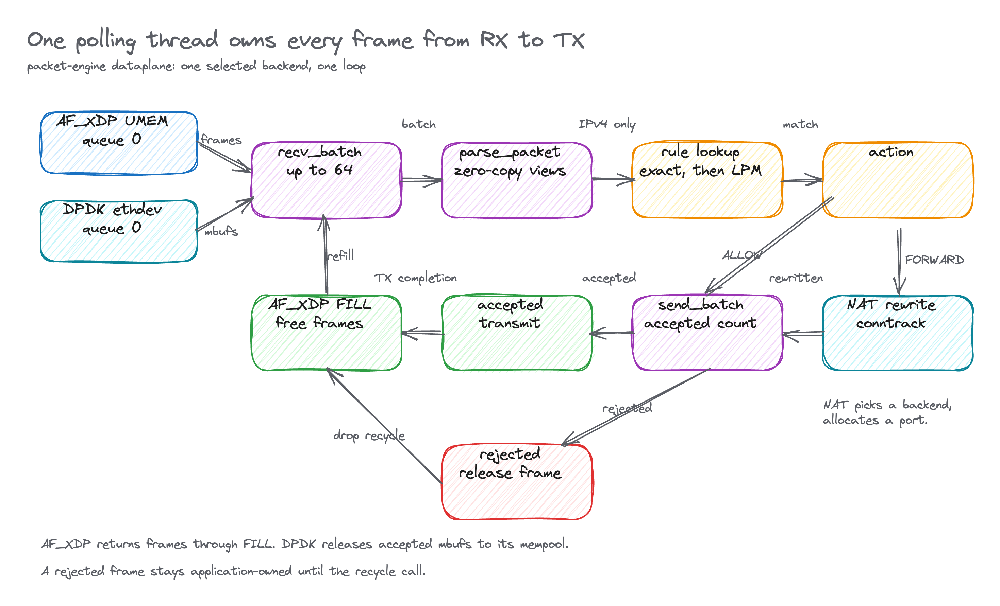
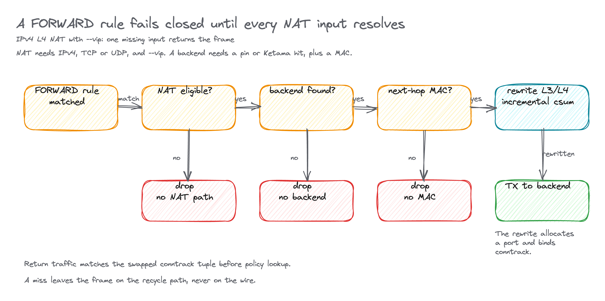
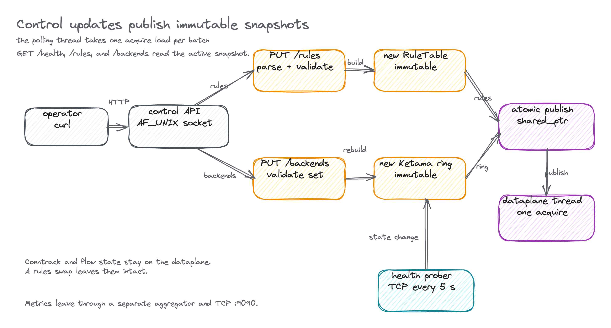

# packet-engine

[](https://en.cppreference.com/w/cpp/23)
[](https://www.kernel.org/)

A userspace packet processor for Linux. It receives frames through AF_XDP or
DPDK, parses them in place, applies an IPv4 policy table, optionally rewrites
them for L4 NAT and load balancing, and transmits them from one
run-to-completion polling thread.

This is a research and portfolio implementation, not a production firewall or
load balancer. The tables below separate what the code implements from what was
exercised on this host.

## What runs

| Area | Behavior | Evidence |
|---|---|---|
| AF_XDP | UMEM RX/TX, FILL and completion recycling, an owned XDP redirect program, and a `getsockopt` mode query. | Needs an interface, BPF and network capabilities, and memlock. Startup prints `mode=copy`, `mode=zero-copy`, or `mode=unknown`. Only `zero-copy` proves zero-copy. |
| DPDK | EAL and ethdev setup, one RX/TX queue, mbuf ownership, and bounded shutdown. | `net_pcap` is tested without privileges. `net_af_packet` is a privileged, copy-backed veth demo. Neither proves PCI kernel bypass or zero-copy. |
| Parser | Ethernet II, one VLAN tag, IPv4, an IPv6 extension walk, TCP, UDP, ICMPv4, ICMPv6 classification, and checksum validation. | IPv4 TCP/UDP fragments fail closed. IPv4 UDP checksum zero is accepted; IPv6 UDP checksum zero is rejected. Policy lookup and NAT are IPv4 only. |
| Policy | Exact IPv4 five-tuple, IPv4 CIDR longest-prefix match, and four actions. | Tables are built off-path and swapped atomically. `RATE_LIMIT` transmits while tokens remain and drops after exhaustion. |
| L4 LB and NAT | Ketama hashing, optional backend pinning, health probing, conntrack, one-arm Ethernet rewrite, and in-place TCP/UDP checksum updates. | Enabled with `--vip`. A `FORWARD` rule without a usable VIP path, backend, or next-hop MAC fails closed. |
| Observability | RX, TX, and drop counters plus a batch-duration histogram. | Histogram values are batch processing times in the executable, not wire RTT. |
| Concurrency | Cache-aligned descriptors, SPSC rings, NUMA topology, worker and frame-allocation components. | The executable runs one queue on one polling thread. The tested worker and SPSC components are not presented as multi-core scaling. |

Kubernetes CNI integration is outside this version. A future demo could expose
the engine as a Multus secondary network. This repository does not install,
configure, or claim a CNI plugin.

## Packet path



Both backends present frames as descriptors. AF_XDP uses offsets into a
4096-frame UMEM; DPDK uses mbufs. The loop takes at most 64 frames per batch and
processes them on the thread that received them.

`parse_packet` builds spans into the original frame. Nothing copies or
allocates before a rule match. IPv4 packets go through `lookup_entry`: exact
five-tuple first, then longest-prefix CIDR on the destination address. Non-IPv4
traffic takes the default action.

`ALLOW` and `RATE_LIMIT` transmit the frame unchanged. A matched `FORWARD` rule
goes through the NAT engine before transmission. Dropped and rejected frames
return to the backend only after the transmit call reports which descriptors it
accepted. AF_XDP frames follow RX ownership through TX completion back to the
FILL ring. DPDK transfers an mbuf to the PMD only when a TX burst accepts it.

## Forwarding decisions



| Action | Behavior |
|---|---|
| `ALLOW` | Transmit unchanged. |
| `DROP` | Return the frame to the recycle path. |
| `RATE_LIMIT` | Transmit while the byte bucket has tokens; drop after exhaustion. |
| `FORWARD` | Rewrite to a backend and transmit on the backend interface. |

A `FORWARD` rule needs `--vip`, an IPv4 TCP or UDP flow, a backend selected by
`backend_id` or the Ketama ring, a non-zero next-hop MAC, and a free ephemeral
port in the range 32768 to 60999. A miss on any of those checks drops the
packet. The forward path rewrites the IPv4 addresses, the L4 ports, both
checksums, and both Ethernet addresses in place. Incremental checksum updates
follow RFC 1624.

The forward path creates a conntrack entry keyed by the original five-tuple and
a translated alias. Return traffic matches the swapped tuple before policy
lookup and is rewritten back to the client. Existing flows keep their backend
when a rule set or ring is replaced. The idle timeout is 120 seconds.

The unmatched default is `DROP` unless `--default-action=allow` is set.
Malformed packets always fail closed.

## Control plane



The control API is an HTTP/1.1 subset over an `AF_UNIX` socket. One `jthread`
accepts connections serially. Requests are capped at 64 KiB, a client has 500 ms
to finish, and the listener only unlinks a socket it still owns. A live socket
belongs to its owner; a stale one is replaced.

| Method | Path | Behavior |
|---|---|---|
| `GET` | `/health` | `{"status":"ok"}` |
| `GET` | `/rules` | Canonical rule array |
| `PUT` | `/rules` | Validate a complete replacement, build a new `RuleTable`, publish it |
| `GET` | `/backends` | Backend array, sorted by id |
| `PUT` | `/backends` | Validate and replace the registry and Ketama ring |
| any | other | `404` |

`PUT /rules` parses the body, validates every rule, builds the new table off
the data path, and swaps one `std::atomic<std::shared_ptr<const RuleTable>>`.
The polling thread takes one acquire load per batch. Readers see the old table
or the new table, never a partial one. An invalid replacement leaves the
current table active.

`PUT /backends` replaces the whole registry. The registry rebuilds the Ketama
ring from healthy backends, with 160 continuum points per backend. An invalid
replacement leaves the current registry and ring active. Existing conntrack
entries remain mutable dataplane state; replacement does not clear them.

The active health prober opens a non-blocking TCP connection to each backend's
`health_port` every 5 seconds, with a 1 second timeout. More than three failures
inside 10 seconds demote a backend from `HEALTHY` to `DEGRADED`, and the ring
drops it from new flow selection. A successful probe restores the backend.

## Build and test

The Nix shell provides CMake 3.25 or newer, Ninja, a C++23 compiler, libxdp,
libbpf, Boost headers, nlohmann-json, GoogleTest, DPDK, libnuma, and
xdp-tools:

```sh
nix develop
```

Without Nix, install those dependencies and use a C++23 compiler.

```sh
# AF_XDP-enabled default build
cmake -S . -B build -G Ninja
cmake --build build -j
ctest --test-dir build --output-on-failure

# Separate DPDK-enabled build
cmake -S . -B build-dpdk -G Ninja -DENABLE_DPDK=ON
cmake --build build-dpdk -j
ctest --test-dir build-dpdk --output-on-failure
```

Each `tests/test_*.cpp` becomes one GoogleTest executable. DPDK-enabled builds
also register the PCAP integration and benchmark scripts with CTest.

`./scripts/build.sh -DENABLE_DPDK=ON` is a convenience wrapper, but it always
uses `build/`. Use separate CMake directories when comparing configurations.
AddressSanitizer and UndefinedBehaviorSanitizer builds use `-DENABLE_ASAN=ON`
and `-DENABLE_UBSAN=ON`.

Quality gates:

```sh
cmake --build build --target format-check
cmake --build build --target shellcheck
cmake --build build --target clang-tidy
```

## Running it

### Unprivileged DPDK PCAP replay

The deterministic integration path uses DPDK's file-backed `net_pcap` PMD. It
runs the real RX, parser, policy, and TX loop and stops after the input packet
count. It needs no root, veth pair, hugepages, or PCI binding.

```sh
cmake -S . -B build-dpdk -G Ninja -DENABLE_DPDK=ON
cmake --build build-dpdk -j

tests/integration/test_dpdk_pcap_cli.sh build-dpdk/packet-engine

# One warmup plus five measured trials; JSON, CSV, PCAPs, and logs are retained.
bench/run_pcap_benchmark.sh --engine build-dpdk/packet-engine
cat bench/results/dpdk-net-pcap/result.json
```

The equivalent engine command is:

```sh
build-dpdk/packet-engine \
  --backend=dpdk \
  --dpdk-port=net_pcap0 \
  --default-action=allow \
  --max-packets=1 \
  --max-idle-ms=1000 \
  --control-socket=/tmp/packet-engine-pcap.sock \
  --metrics-port=9191 \
  -- \
  -l 0 -n 1 --no-huge --no-pci \
  --file-prefix=packet-engine-pcap \
  --vdev=net_pcap0,rx_pcap=input.pcap,tx_pcap=output.pcap
```

`net_pcap` copies between PCAP records and DPDK mbufs. This path proves real
DPDK poll-mode software-PMD I/O and engine composition. It does not measure
zero-copy or native NIC performance.

### AF_XDP

A live AF_XDP run needs an existing interface and normally `CAP_NET_ADMIN`,
`CAP_BPF` or `CAP_SYS_ADMIN` as the host kernel requires, plus enough
`RLIMIT_MEMLOCK`. The engine loads and detaches its own XDP program; do not
preload a second redirect program with `xdp-loader`.

```sh
sudo -E build/packet-engine \
  --backend=af_xdp \
  --interface=veth0 \
  --queue=0 \
  --max-idle-ms=5000 \
  --control-socket=/tmp/packet-engine.sock \
  --metrics-port=9090
```

A successful start prints one of these lines:

```text
capability backend=af_xdp interface=veth0 queue=0 mode=zero-copy
capability backend=af_xdp interface=veth0 queue=0 mode=copy
capability backend=af_xdp interface=veth0 queue=0 mode=unknown
```

The value comes from `getsockopt(SOL_XDP, XDP_OPTIONS)`. A successful socket or
an AF_XDP label alone is not a zero-copy result. The veth path is expected to be
copy mode. A physical NIC and driver test is required to prove zero-copy.

`scripts/dev-run.sh shell` creates a root-required veth pair and removes only
the pair it created. `bench/run_engine_bench.sh` is the capability-gated live
AF_XDP and tcpreplay harness. Both harnesses track their children and
terminate them from `EXIT`, `INT`, and `TERM` cleanup paths.

### DPDK AF_PACKET veth demo

When the installed DPDK includes `net_af_packet`, the same one-queue runtime can
poll a veth interface:

```sh
sudo -E build-dpdk/packet-engine \
  --backend=dpdk \
  --dpdk-port=net_af_packet0 \
  --default-action=allow \
  --max-idle-ms=5000 \
  -- \
  -l 0 -n 1 --no-huge --no-pci \
  --file-prefix=packet-engine-af-packet \
  --vdev=net_af_packet0,iface=veth0,qpairs=1,qdisc_bypass=1
```

This needs `CAP_NET_RAW`; creating the veth pair needs `CAP_NET_ADMIN`.
AF_PACKET uses kernel packet sockets and PACKET_MMAP and copies into DPDK
mbufs. This demo exercises the copy path through the kernel, not kernel
bypass.

## CLI

```text
--backend=af_xdp|dpdk    datapath backend (default: af_xdp)
--interface=NAME         AF_XDP interface (default: veth0)
--queue=N                queue id (default: 0; DPDK supports queue 0 only)
--dpdk-port=NAME         required named DPDK port or vdev
--max-packets=N          stop after N received packets
--max-idle-ms=N          stop after N idle milliseconds
--control-socket=PATH    Unix control socket
--metrics-port=PORT      Prometheus TCP listen port
--vip=IPv4               enable IPv4 L4 NAT for this virtual IP
--default-action=ACTION  unmatched policy: drop|allow (default: drop)
--                       remaining arguments go to DPDK EAL
```

SIGINT and SIGTERM request a bounded loop shutdown. AF_XDP detaches its owned
BPF link. DPDK stops and closes the port, frees application-owned mbufs and its
mempool, and calls EAL cleanup.

## Rules and backends

A rule matches by exactly one of `tuple` or `cidr`. Rule ids and rule
`backend_id` values are decimal unsigned strings.

```json
[
  {
    "id": "1",
    "tuple": {
      "src_ip": "10.99.0.2",
      "dst_ip": "10.99.0.1",
      "src_port": 12345,
      "dst_port": 443,
      "proto": "tcp"
    },
    "action": "ALLOW"
  },
  {
    "id": "2",
    "cidr": "192.0.2.0/24",
    "action": "DROP"
  },
  {
    "id": "3",
    "cidr": "198.51.100.0/24",
    "action": "RATE_LIMIT",
    "rate_bps": 1000000,
    "burst_bytes": 200000
  },
  {
    "id": "4",
    "cidr": "203.0.113.0/24",
    "action": "FORWARD",
    "backend_id": "10"
  }
]
```

The field name `rate_bps` is historical. Its unit is bytes per second.
`burst_bytes` is bytes. A `RATE_LIMIT` rule requires both fields with non-zero
values.

For `FORWARD`, omit `backend_id` to hash new flows across healthy backends with
Ketama, or set it to pin new flows to one backend. A pinned backend must be
healthy. `FORWARD` also requires `--vip`; otherwise packets fail closed.

```sh
curl --unix-socket /tmp/packet-engine.sock \
  -H 'Content-Type: application/json' \
  -X PUT --data-binary @rules.json http://localhost/rules

curl --unix-socket /tmp/packet-engine.sock http://localhost/rules
curl --unix-socket /tmp/packet-engine.sock http://localhost/health
```

A backend update is a complete replacement. Each object needs a unique `id`
below `4294967295`, a unique non-empty `authority`, and a `health_port` in the
unsigned 16-bit range. The optional `mac` is a non-zero Ethernet address and is
required for `FORWARD` traffic. NAT expects an IPv4 `authority` in
`address:port` form.

```json
[
  {"id": 10, "authority": "10.0.0.10:8080", "health_port": 9080, "mac": "02:00:00:00:00:10"},
  {"id": 11, "authority": "10.0.0.11:8080", "health_port": 9081, "mac": "02:00:00:00:00:11"}
]
```

```sh
curl --unix-socket /tmp/packet-engine.sock \
  -H 'Content-Type: application/json' \
  -X PUT --data-binary @backends.json http://localhost/backends
curl --unix-socket /tmp/packet-engine.sock http://localhost/backends
```

Invalid replacement arrays leave the prior registry and ring active.

## Metrics

`GET http://127.0.0.1:9090/metrics` exports Prometheus text format. The port
comes from `--metrics-port`. The endpoint also serves `GET /health`.

- `engine_rx_packets_total`
- `engine_tx_packets_total`
- `engine_drops_total`
- `engine_latency_seconds_bucket`
- `engine_latency_seconds_sum`
- `engine_latency_seconds_count`

Packet and drop rates are counter deltas:

```promql
rate(engine_rx_packets_total[1m])
rate(engine_drops_total[1m])
histogram_quantile(0.50, sum by (le) (rate(engine_latency_seconds_bucket[5m])))
histogram_quantile(0.99, sum by (le) (rate(engine_latency_seconds_bucket[5m])))
```

The runtime records one duration per processed batch, so the histogram
describes application batch-processing time. It is not a hardware or end-to-end
packet timestamp.

## Benchmark

The committed result in `bench/results/dpdk-net-pcap/` replays 10,000
deterministic 60-byte packets per trial. Each trial includes process startup,
EAL initialization, replay, TX flush, and teardown, and checks every output
record byte-for-byte against the input.

| Path | Status | Trials | Median packets/s | Drops | p50/p99 latency |
|---|---:|---:|---:|---:|---|
| DPDK `net_pcap` offline replay | PASS | 5 + 1 warmup | 27,850.459 | 0 | N/A |
| AF_XDP live comparison | BLOCKED | 0 | N/A | N/A | Requires privileges, interface, and memlock |
| Linux kernel veth and nftables | BLOCKED | 0 | N/A | N/A | Requires `CAP_NET_ADMIN` |

The measured trials ranged from 24,503.933 to 30,427.172 packets per second on
the host recorded in `result.json`: an AMD Ryzen 7 5700X, kernel 7.1.3, DPDK
26.03, and the `net_pcap` PMD. The spread is retained. The median is
startup-inclusive and machine-specific, so it is a functional baseline, not NIC
forwarding capacity.

Offline replay has no correlated ingress and egress timestamps. Mapping process
duration to p50 or p99 latency would invent a metric, so the JSON records both
as `null` with a reason.

See [bench/README.md](bench/README.md) for the schema, provenance, and the
privileged comparison protocol.

## Limits

- One queue and one polling thread are composed by the executable. Multi-queue
  RSS and multi-core scaling are not claimed.
- The active JSON policy path matches IPv4 only. IPv6 parsing works, but IPv6
  policy publication, endpoint keys, and NAT are incomplete.
- NAT covers TCP and UDP and the in-place forward path. It has no ICMP NAT,
  IPv6 NAT, fragment reassembly, ALG, SYN proxy, or DDoS protection.
- The executable uses one interface or DPDK port for both directions and a
  static one-arm Ethernet next hop per backend. It has no ARP, neighbor
  discovery, routing table, or distinct client and backend ports.
- The software-PMD evidence is copy-backed. Kernel bypass, line rate, lossless
  forwarding, cycles per packet, and zero-copy claims need a dedicated PCI
  PMD, hugepages, IOMMU, NUMA, independent generator and receiver, and hardware
  counters.
- The AF_XDP link is process-owned and unpinned. Missing or full XSK redirects
  drop only while the link stays attached. A crash-persistent firewall needs an
  external pinned guard or kernel-path isolation.
- NUMA-aware components are implemented, but the one-thread runtime does not
  expose a verified queue-to-core-to-NIC NUMA report.
- The control socket is local and unauthenticated. Metrics are plaintext.
- Kubernetes CNI support, production hardening, and compatibility guarantees
  are out of scope.

## Repository layout

| Path | Contents |
|---|---|
| `include/packet-engine/` | Public headers: parser, policy, NAT, backends, metrics |
| `src/` | Implementation and the executable composition root |
| `bpf/` | XDP redirect program built with the engine |
| `tests/` | GoogleTest suites, mocks, and PCAP integration scripts |
| `bench/` | Benchmark harness, protocol notes, and committed results |
| `scripts/` | Build wrapper and veth development harness |
| `docs/figures/` | Excalidraw sources, rendered PNGs, and the generator |

## References

- [Linux AF_XDP documentation](https://docs.kernel.org/networking/af_xdp.html)
- [Linux XDP redirect documentation](https://docs.kernel.org/bpf/redirect.html)
- [DPDK ethdev programming guide](https://doc.dpdk.org/guides/prog_guide/ethdev/ethdev.html)
- [DPDK PCAP poll-mode driver](https://doc.dpdk.org/guides/nics/pcap_ring.html)
- [Prometheus histograms](https://prometheus.io/docs/practices/histograms/)
